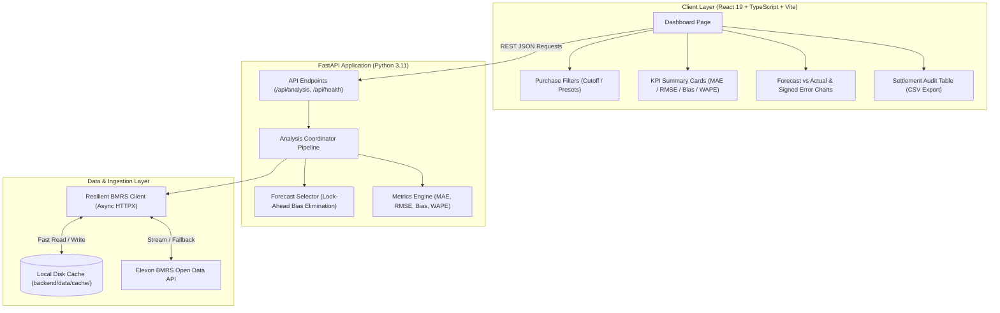

# Wind Forecast Intelligence — UK Day-Ahead Analytics

> 🌐 **Live Deployed Frontend (Vercel):** [https://wind-forecast-omega.vercel.app/](https://wind-forecast-omega.vercel.app/)  
> ⚡ **Live Deployed Backend API (Render):** [https://wind-forecast-api-yj50.onrender.com/](https://wind-forecast-api-yj50.onrender.com/) *(Interactive Swagger Docs: [/docs](https://wind-forecast-api-yj50.onrender.com/docs) \| Health: [/api/health](https://wind-forecast-api-yj50.onrender.com/api/health))*

A complete, production-ready analytics web application built for UK electricity utilities purchasing power in the Day-Ahead wholesale market. The application ingests genuine wind generation actuals and rolling forecasts from the **Elexon BMRS Open Data API**, matches delivery periods strictly respecting day-ahead purchase decision cutoffs, and quantifies forecast errors using transparent statistical metrics.

## Application Screenshots

### Live Elexon BMRS Analysis (January 2026)

*Figure 1: Wind Forecast Intelligence Dashboard displaying genuine January 2026 Elexon BMRS observations (1,488 half-hour settlement periods), interactive KPI summary cards, Forecast vs. Actual overlay timeline with zoom brush, signed error distribution chart, and the settlement period audit table.*

### Synthetic Demo Mode & Offline Fixtures

*Figure 2: Synthetic Demo Mode activated via the header toggle. Renders deterministic edge cases, missing data flags, and provides an offline fallback without modifying the production API path.*

---

## 1. Business Problem & Procurement Context

An electricity utility purchasing power in the UK wholesale day-ahead market (EPEX SPOT / Nord Pool UK Day-Ahead auctions) must estimate how much electricity to purchase beyond expected renewable self-generation. 

* **The Problem:** Wind generation is intermittent and weather-dependent. Forecast errors create substantial procurement and financial risk:
  * **Overforecasting ($Forecast > Actual$, Positive Bias):** The utility procures too little wholesale power, leading to an unexpected short position that must be settled in the Balancing Mechanism at volatile, elevated system cashout prices.
  * **Underforecasting ($Forecast < Actual$, Negative Bias):** The utility purchases surplus power that physically spills or must be sold off in intraday markets at distress discounts.
* **The Solution:** This application helps trading and procurement teams:
  1. Freeze and analyze the latest wind generation forecast available before the day-ahead auction cutoff.
  2. Compare that selected forecast with subsequently observed actual wind outturn.
  3. Quantify forecast error magnitude, direction, and risk with transparent metrics.

---

## 2. Data Provider & API Schema Documentation

All data is ingested from the **Elexon Insights Solution (BMRS) API** (`https://data.elexon.co.uk/bmrs/api/v1`):

### A. Actual Generation Dataset: `FUELHH`
* **Documentation & Endpoint:** `GET /datasets/FUELHH/stream` ([Elexon API Docs](https://bmrs.elexon.co.uk/api-documentation/endpoint/datasets/FUELHH/stream))
* **Granularity:** Half-hourly delivery periods (Settlement Periods 1 to 48/50).
* **Applied Query Parameters:** `settlementDateFrom=YYYY-MM-DD`, `settlementDateTo=YYYY-MM-DD`, `fuelType=WIND`
* **Key Fields Used:**
  * `startTime`: UTC ISO 8601 delivery period start timestamp.
  * `generation`: Observed outturn in Megawatts (MW).
  * `fuelType`: Filtered for `"WIND"`.
  * `settlementDate`: UK settlement date (YYYY-MM-DD).
  * `settlementPeriod`: Settlement period number (1 to 48/50).

### B. Forecast Dataset: `WINDFOR`
* **Documentation & Endpoint:** `GET /datasets/WINDFOR/stream` ([Elexon API Docs](https://bmrs.elexon.co.uk/api-documentation/endpoint/datasets/WINDFOR/stream))
* **Granularity:** Hourly target delivery periods issued at rolling intervals throughout the day.
* **Applied Query Parameters:** `publishDateTimeFrom=...`, `publishDateTimeTo=...`
* **Key Fields Used:**
  * `startTime`: Target forecast delivery period timestamp.
  * `publishTime`: Timestamp when National Grid ESO published this specific forecast revision.
  * `generation`: Predicted wind generation in Megawatts (MW).

### Time Resolution Alignment & Granularity Nuance
* While `FUELHH` outturns are recorded every 30 minutes (Settlement Periods 1 to 48), `WINDFOR` is issued by National Grid ESO on clock-hour boundaries (60-minute intervals).
* The application supports two documented matching strategies via `resolution_matching`:
  1. `hourly_block` (Default wholesale market convention): Maps the hourly ESO forecast across both half-hour settlement periods in that hour ($HH$:00 and $HH$:30).
     * **Analytical Transparency Note:** Mapping one hourly forecast across two half-hour delivery periods does *not* create two independent forecasts. It is a step-function volume attribution matching the commercial convention of UK power trading desks evaluating half-hourly imbalance against hourly day-ahead auction blocks.
  2. `exact_timestamp` (Strict Pairing): Strictly matches only top-of-the-hour ($HH$:00) periods. The :30 periods are explicitly flagged as `MISSING_FORECAST` with zero silent discarding (yielding 744 valid pairs and 744 missing forecast periods in a 31-day month).

---

## 3. Critical Forecast Selection Logic & Look-Ahead Bias Prevention

1. **Separation of Concepts:**
   * **Target Delivery Period ($T_{\text{delivery}}$):** The half-hour window when power physically flows through the national transmission system.
   * **Forecast Publication Time ($T_{\text{pub}}$):** The timestamp when National Grid ESO calculated and issued the forecast update.
   * **Purchase Decision Cutoff ($T_{\text{cutoff}}$):** The trading gate closure deadline when day-ahead auction bids are submitted.

2. **Cutoff Assumption & Market Alignment:**
   * **Configured Default:** `day_ahead_fixed` at **11:00 UK local time on Day D-1**.
   * **Analytical Assumption Disclosure:** The 11:00 London local time cutoff on Day D-1 is a **configurable analytical assumption** modeled on the order submission deadline for Great Britain's Day-Ahead wholesale power auction (EPEX SPOT UK Day-Ahead Auction order book closes at 11:00 London time). It represents the moment when commercial volume purchasing decisions must be finalized. Users can freely configure alternative cutoff assumptions via the UI or API (e.g. 09:00, 12:00, 16:00, or relative hours lead) to evaluate sensitivity across procurement windows.
   * **Timezone Normalization:** Implemented using Python's `zoneinfo.ZoneInfo("Europe/London")` to account for Greenwich Mean Time (GMT, UTC+0) and British Summer Time (BST, UTC+1). On clock change dates, 11:00 BST translates to 10:00 UTC.

3. **Selection Rule & Look-Ahead Prevention:**
   * A forecast record $f$ for target period $T_{\text{delivery}}$ is eligible if and only if:
     $$f.publishTime \le T_{\text{cutoff}}$$
   * **Strict Look-Ahead Bias Exclusion:** Any forecast published after $T_{\text{cutoff}}$ (such as late afternoon updates or real-time intraday adjustments) is excluded.
   * **Latest Eligible Selection:** Among all eligible candidates, the record with $\max(f.publishTime)$ is selected.
   * **Transparent Status Reporting:** Every period in the time grid is tracked as `VALID_PAIR`, `MISSING_FORECAST`, `MISSING_ACTUAL`, or `MISSING_BOTH`.

---

## 4. Accuracy Metrics & Formulation

Calculated across all $N$ valid pairs:
* **Error:** $e_i = Forecast_i - Actual_i$ (MW)
* **Absolute Error:** $|e_i| = |Forecast_i - Actual_i|$ (MW)
* **MAE (Mean Absolute Error):**
  $$\text{MAE} = \frac{1}{N} \sum_{i=1}^{N} |e_i| \quad (\text{MW})$$
* **RMSE (Root Mean Squared Error):**
  $$\text{RMSE} = \sqrt{\frac{1}{N} \sum_{i=1}^{N} e_i^2} \quad (\text{MW})$$
* **Bias (Mean Signed Error):**
  $$\text{Bias} = \frac{1}{N} \sum_{i=1}^{N} e_i \quad (\text{MW})$$
  *(Positive = systematic overforecasting / short imbalance risk; Negative = systematic underforecasting / spill risk)*
* **WAPE (Weighted Absolute Percentage Error):**
  $$\text{WAPE} = \frac{\sum_{i=1}^{N} |e_i|}{\sum_{i=1}^{N} Actual_i} \times 100\%$$
  *(If $\sum Actual_i = 0$, WAPE is safely returned as `null` with no division-by-zero error)*
* **Why MAPE is Omitted:** Mean Absolute Percentage Error ($\frac{1}{N} \sum \frac{|F - A|}{A}$) divides by actual generation in each period. When actual wind drops near 0 MW, MAPE creates infinite or distorted percentage spikes. WAPE provides an industry-standard volume-weighted error.

---

## 5. Technology Stack & System Architecture

### A. Technology Stack
* **Frontend:** React 19, Vite, TypeScript, Tailwind CSS, Recharts, Lucide Icons.
* **Backend:** Python 3.11, FastAPI, Pandas, HTTPX (async client with exponential backoff retries), Pydantic v2.
* **Testing:** Pytest, Pytest-Asyncio (deterministic fixtures with zero external network dependencies).
* **Containerization:** Docker multi-stage builds and Docker Compose with healthchecks.

### B. System Architecture Diagram



```text
┌────────────────────────────────────────────────────────────────────────┐
│                        BROWSER / CLIENT LAYER                          │
│  React 19 + TypeScript + Vite + Tailwind CSS + Recharts (Port 5173)   │
└────────────────────────────────────┬───────────────────────────────────┘
                                     │ HTTP REST Requests (/api/analysis)
                                     ▼
┌────────────────────────────────────────────────────────────────────────┐
│                        FASTAPI BACKEND LAYER                           │
│              Python 3.11 + FastAPI + Pydantic v2 (Port 8000)          │
│                                                                        │
│  ┌─────────────────────────┐          ┌─────────────────────────────┐  │
│  │   Forecast Selector     │          │       Metrics Engine        │  │
│  │ (Cutoff & Look-Ahead)   │          │    (MAE, RMSE, Bias, WAPE)  │  │
│  └───────────▲─────────────┘          └──────────────▲──────────────┘  │
│              │                                       │                 │
│  ┌───────────┴───────────────────────────────────────┴──────────────┐  │
│  │                    Analysis Coordinator Pipeline                  │  │
│  └─────────────────────────────────▲────────────────────────────────┘  │
│                                    │                                   │
│  ┌─────────────────────────────────┴────────────────────────────────┐  │
│  │                BMRS Ingestion Client (Async HTTPX)                │  │
│  └───────────────┬───────────────────────────────────▲──────────────┘  │
└──────────────────┼───────────────────────────────────┼─────────────────┘
                   │ Cache Miss (Fetch)                │ Read
                   ▼                                   │
┌─────────────────────────────────────┐  ┌─────────────┴───────────────┐
│     ELEXON BMRS OPEN DATA API       │  │    LOCAL PERSISTENT CACHE   │
│ https://data.elexon.co.uk/bmrs/api/v1 │ │     (backend/data/cache/)   │
│   - /datasets/FUELHH/stream         │  │   - FUELHH_WIND_*.json      │
│   - /datasets/WINDFOR/stream        │  │   - WINDFOR_*.json          │
└─────────────────────────────────────┘  └─────────────────────────────┘
```

### C. Folder Structure

```text
welllass/
├── backend/
│   ├── app/
│   │   ├── api/
│   │   │   ├── __init__.py
│   │   │   └── routes.py              # GET /api/health, /api/metadata, /api/analysis
│   │   ├── clients/
│   │   │   ├── __init__.py
│   │   │   └── bmrs_client.py         # HTTPX client with retries, timeouts, and disk cache
│   │   ├── schemas/
│   │   │   ├── __init__.py
│   │   │   └── models.py              # Pydantic models for raw feeds, metrics, and responses
│   │   ├── services/
│   │   │   ├── __init__.py
│   │   │   ├── analysis_service.py    # Pipeline coordinator (live, cache, and demo modes)
│   │   │   ├── forecast_selector.py   # Cutoff determination, look-ahead exclusion, matching
│   │   │   ├── metrics.py             # MAE, RMSE, Bias, WAPE, and energy calculations
│   │   │   └── synthetic_generator.py # Deterministic synthetic datasets
│   │   ├── config.py                  # Settings with environment variable overrides
│   │   └── main.py                    # FastAPI entrypoint with CORS
│   ├── tests/
│   │   ├── conftest.py                # Test fixtures and path setup
│   │   ├── test_api.py                # FastAPI route integration tests
│   │   ├── test_bmrs_client.py        # Client tests: retries, caching, error codes
│   │   ├── test_forecast_selector.py  # Cutoff logic, DST, look-ahead exclusion, matching
│   │   └── test_metrics.py            # Known numerical benchmarks and zero denominator tests
│   ├── data/
│   │   ├── cache/                     # Local disk cache for BMRS streams
│   │   └── fixtures/                  # Offline deterministic fixtures
│   ├── Dockerfile                     # Python 3.11 slim production container
│   └── requirements.txt               # Pinned dependencies
├── frontend/
│   ├── src/
│   │   ├── components/                # Header, Filters, KpiCards, Charts, DataTable, Banners
│   │   ├── pages/                     # Dashboard.tsx
│   │   ├── services/                  # api.ts (typed client) and mockData.ts (demo fixture)
│   │   ├── types/                     # TypeScript interfaces
│   │   ├── App.tsx
│   │   ├── main.tsx
│   │   └── index.css                  # Tailwind styles
│   ├── nginx.conf                     # Production Nginx SPA & proxy config
│   ├── Dockerfile                     # Multi-stage Nginx container
│   ├── package.json
│   ├── tsconfig.json
│   ├── vite.config.ts
│   └── vercel.json                    # Vercel deployment rewrites
├── docker-compose.yml                 # Multi-container orchestration
├── .env.example                       # Documented environment variables
├── .gitignore
└── README.md
```

---

## 6. How to Run Locally

### Option A: Local Development (Terminal)

1. **Install backend dependencies:**
   ```bash
   pip install -r backend/requirements.txt
   ```

2. **Start the FastAPI backend (Port 8000):**
   ```bash
   python -m uvicorn backend.app.main:app --host 127.0.0.1 --port 8000 --reload
   ```

3. **Install frontend dependencies & start dev server (Port 5173):**
   ```bash
   cd frontend
   npm install
   npm run dev
   ```

4. **Access the application:**
   * Frontend: [http://localhost:5173/](http://localhost:5173/)
   * Backend OpenAPI Docs: [http://localhost:8000/docs](http://localhost:8000/docs)
   * Backend Healthcheck: [http://localhost:8000/api/health](http://localhost:8000/api/health)

### Option B: Docker Compose

Ensure Docker Engine is running on your machine:
```bash
docker-compose up --build
```
* **Frontend:** [http://localhost:3000](http://localhost:3000) (Nginx SPA proxying `/api` requests to backend)
* **Backend:** [http://localhost:8000](http://localhost:8000)
* **Persistent Disk Cache:** Mounted to `./backend/data/cache` so Elexon stream responses persist across runs.

---

## 7. Verified Deployment Guide & Live Links

### Verified Live Endpoints
* 🌐 **Production Frontend (Vercel):** [https://wind-forecast-omega.vercel.app/](https://wind-forecast-omega.vercel.app/)
* ⚡ **Production Backend API (Render):** [https://wind-forecast-api-yj50.onrender.com/](https://wind-forecast-api-yj50.onrender.com/)
* 📖 **Interactive OpenAPI Documentation:** [https://wind-forecast-api-yj50.onrender.com/docs](https://wind-forecast-api-yj50.onrender.com/docs)
* 🩺 **Backend Healthcheck:** [https://wind-forecast-api-yj50.onrender.com/api/health](https://wind-forecast-api-yj50.onrender.com/api/health)

### Verification & Data Flow
* **Live Connection Verified:** The Vercel frontend actively retrieves analysis data from the Render backend.
* **CORS Policy:** Render's `CORSMiddleware` explicitly allows `https://wind-forecast-omega.vercel.app` as well as any Vercel deployment domain via regex (`^https:\/\/.*\.vercel\.app$`).
* **Data Sources Verified:** The backend queries genuine Elexon BMRS Open Data streams, with persistent local caching in `backend/data/cache/` to insulate trading queries from external rate limits. Offline testing is fully supported via the synthetic Demo Mode toggle.

### A. Backend Deployment (Render or Docker)
* **Build Context:** Repository Root (`.`)
* **Dockerfile Path:** `backend/Dockerfile`
* **Exposed Port:** `8000`
* **Environment Variables:**
  ```ini
  ELEXON_API_BASE_URL=https://data.elexon.co.uk/bmrs/api/v1
  ELEXON_HTTP_TIMEOUT=30.0
  DEFAULT_START_DATE=2026-01-01
  DEFAULT_END_DATE=2026-01-31
  DEFAULT_CUTOFF_TIME_UK=11:00
  CORS_ORIGINS=https://wind-forecast-omega.vercel.app,http://localhost:3000,http://localhost:5173
  DEBUG=False
  ```
* **Healthcheck:** `GET /api/health`

### B. Frontend Deployment (Vercel)

1. **Live Production URL:** [https://wind-forecast-omega.vercel.app/](https://wind-forecast-omega.vercel.app/)
2. **Vercel Project Setup:**
   * **Root Directory:** `frontend`
   * **Framework Preset:** `Vite`
   * **Build Command:** `npm run build`
   * **Output Directory:** `dist`
3. **Environment Variables in Vercel:**
   ```ini
   VITE_API_URL=https://wind-forecast-api-yj50.onrender.com
   ```
4. **SPA Routing:** `frontend/vercel.json` is configured with rewrites so deep routes navigate to `index.html` without 404 errors.

---

## 8. Accuracy Calculations & Testing Suite

### A. Accuracy Formulations & Market Risk

$$\text{Signed Error}_i = \text{Forecast}_i - \text{Actual}_i \quad (\text{MW})$$

* **Mean Absolute Error (MAE):**
  $$\text{MAE} = \frac{1}{N} \sum_{i=1}^{N} |\text{Forecast}_i - \text{Actual}_i| \quad (\text{MW})$$
  *Measures average error magnitude. Half-hour volume deviation in MWh is computed as $\text{MAE} \times 0.5\text{ h}$.*
* **Root Mean Squared Error (RMSE):**
  $$\text{RMSE} = \sqrt{\frac{1}{N} \sum_{i=1}^{N} (\text{Forecast}_i - \text{Actual}_i)^2} \quad (\text{MW})$$
  *Heavily penalizes extreme forecast blowouts. The spread $(\text{RMSE} - \text{MAE})$ quantifies error volatility.*
* **Mean Bias (Signed Directional Error):**
  $$\text{Bias} = \frac{1}{N} \sum_{i=1}^{N} (\text{Forecast}_i - \text{Actual}_i) \quad (\text{MW})$$
  *Positive ($>0$) = Overforecasting (Utility under-buys in Day-Ahead; left short at cashout prices).*
  *Negative ($<0$) = Underforecasting (Utility over-buys; surplus power physically spills).*
* **Weighted Absolute Percentage Error (WAPE):**
  $$\text{WAPE} = \frac{\sum_{i=1}^{N} |\text{Forecast}_i - \text{Actual}_i|}{\sum_{i=1}^{N} \text{Actual}_i} \times 100\%$$
  *Normalized against total monthly generation. If $\sum \text{Actual} == 0$, WAPE safely returns `null`.*
* **Why MAPE is Omitted:** When wind generation drops near zero MW, $\frac{|F - A|}{A}$ divides by near-zero, generating false $10,000\%+$ percentage spikes. WAPE is mathematically immune to zero-division distortion.

### B. Automated Test Suite (23 Passing Tests)

The test suite runs with **zero network dependency** using deterministic fixtures:

```bash
python -m pytest backend/tests -v
```

```text
backend/tests/test_api.py::test_root_endpoint PASSED
backend/tests/test_api.py::test_health_endpoint PASSED
backend/tests/test_api.py::test_metadata_endpoint PASSED
backend/tests/test_api.py::test_analysis_endpoint_demo_mode PASSED
backend/tests/test_api.py::test_analysis_invalid_date_range PASSED
backend/tests/test_api.py::test_analysis_range_exceeds_limit PASSED
backend/tests/test_bmrs_client.py::test_client_reads_from_cache PASSED
backend/tests/test_bmrs_client.py::test_client_fetch_with_retries_and_error PASSED
backend/tests/test_bmrs_client.py::test_client_non_retryable_400 PASSED
backend/tests/test_forecast_selector.py::test_cutoff_computation_gmt_winter PASSED
backend/tests/test_forecast_selector.py::test_cutoff_computation_bst_summer_daylight_saving PASSED
backend/tests/test_forecast_selector.py::test_cutoff_computation_relative_hours PASSED
backend/tests/test_forecast_selector.py::test_latest_eligible_forecast_selection_and_post_cutoff_rejection PASSED
backend/tests/test_forecast_selector.py::test_missing_forecast_when_all_forecasts_post_cutoff PASSED
backend/tests/test_forecast_selector.py::test_missing_actual_outturn PASSED
backend/tests/test_forecast_selector.py::test_duplicate_records_deduplication PASSED
backend/tests/test_forecast_selector.py::test_settlement_period_numbering PASSED
backend/tests/test_forecast_selector.py::test_resolution_matching_hourly_block_vs_exact PASSED
backend/tests/test_metrics.py::test_known_numerical_metrics PASSED
backend/tests/test_metrics.py::test_positive_bias_overforecasting PASSED
backend/tests/test_metrics.py::test_negative_bias_underforecasting PASSED
backend/tests/test_metrics.py::test_zero_denominator_wape_handling PASSED
backend/tests/test_metrics.py::test_empty_pairs_list PASSED

============================== 23 passed in 1.51s ==============================
```

---

## 9. Verified & Reproducible January 2026 Analytical Findings

Executing the analytical pipeline on genuine Elexon BMRS observations for the entire month of January 2026 ($N = 1,488$ half-hour periods) with the configured 11:00 D-1 Day-Ahead cutoff yields reproducible results:

### A. Primary Mode: Hourly Block Mapping (`resolution_matching="hourly_block"`)
* **Analysis Window:** 2026-01-01 00:00:00Z to 2026-01-31 23:30:00Z ($31 \text{ days} \times 48 \text{ settlement periods}$)
* **Total Expected Settlement Periods:** $1,488$
* **Valid Matched Pairs:** $1,488$ ($100.0\%$ complete; $0$ missing forecasts, $0$ missing actuals)
* **Mean Absolute Error (MAE):** $2,126.12 \text{ MW}$ ($1,063 \text{ MWh/period}$)
* **Root Mean Squared Error (RMSE):** $2,620.80 \text{ MW}$ ($+495 \text{ MW}$ volatility spread vs MAE)
* **Mean Bias:** $+1,840.30 \text{ MW}$ *(systematic day-ahead overforecasting by National Grid ESO across January 2026)*
* **Weighted Absolute Percentage Error (WAPE):** $18.36\%$
* **Total Wind Energy Delivered:** $8,616,068.5 \text{ MWh}$ (~8.62 TWh)
* **Total Wind Energy Forecasted:** $9,985,249.0 \text{ MWh}$ (~9.99 TWh)

### B. Strict Pairing Mode: Exact Timestamp Only (`resolution_matching="exact_timestamp"`)
* **Total Expected Periods:** $1,488$
* **Valid Matched Pairs:** $744$ (:00 clock hours strictly paired)
* **Explicit Missing Forecasts:** $744$ (:30 half-hour periods without direct hourly forecast)
* **Data Completeness:** $50.0\%$
* **Mean Absolute Error (MAE):** $2,107.18 \text{ MW}$
* **Root Mean Squared Error (RMSE):** $2,611.24 \text{ MW}$
* **Mean Bias:** $+1,839.92 \text{ MW}$
* **Weighted Absolute Percentage Error (WAPE):** $18.19\%$

---

## 10. Honest Disclosures, Limitations & AI Tool Usage

* **AI Tool Usage:** Antigravity (Google DeepMind agentic coding assistant) was utilized for scaffolding, test generation, and frontend component assembly. All code, analytical logic, schemas, and mathematical metrics were verified.
* **Limitations & Known Edge Cases:**
  * National Grid ESO publishes `WINDFOR` at hourly resolution, while `FUELHH` outturn is half-hourly. The default `hourly_block` strategy maps hourly forecasts to both half-hours; the `exact_timestamp` option provides strict timestamp matching.
  * Elexon BMRS API can experience intermittent rate limits or latency during heavy stream downloads; the local cache ensures high availability once data has been fetched.
* **Verified Deployment Status:** 
  * Frontend is deployed and verified live on **Vercel**: [https://wind-forecast-omega.vercel.app/](https://wind-forecast-omega.vercel.app/)
  * Backend API is deployed and verified live on **Render**: [https://wind-forecast-api-yj50.onrender.com/](https://wind-forecast-api-yj50.onrender.com/)
  * Local development servers and multi-stage Docker Compose have both been verified.
